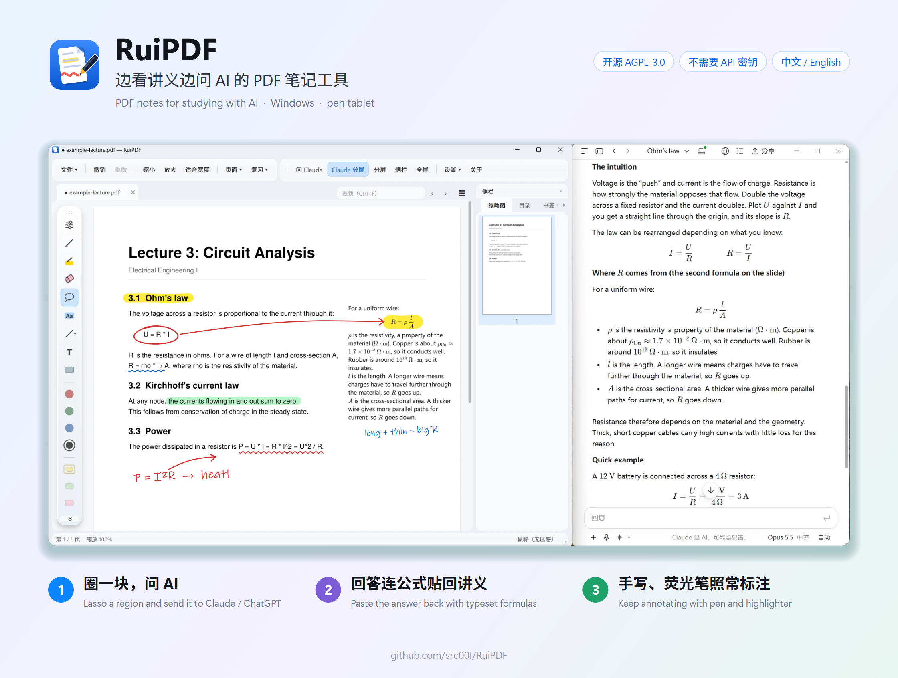

# RuiPDF

**边看讲义边问 AI 的 PDF 笔记工具**（Windows，配合数位板手写）。
A PDF note-taking tool for studying with AI, on Windows with a pen tablet. **[English below](#english)**.

用 AI 学习时，回答里常常带着公式。想把它记到讲义上，要么手抄一遍，很慢；要么粘贴进去，公式变成一堆 `$\frac{...}$` 源码。RuiPDF 把这两步都变成一下：

1. **问**：在讲义上圈一块，一键把截图（或选中的文字）送进贴靠在旁边的 Claude / ChatGPT 窗口。用的是你自己的桌面应用，不需要 API 密钥。
2. **记**：把回答复制回来按 Ctrl+V，公式、表格、代码自动排好版，以矢量内容贴在讲义上，之后还能改原文、改宽度。

除此之外，它也是一个完整的手写标注工具：压感笔、荧光笔、套索、文字、遮挡复习。



## 功能

- **书写**：压感钢笔、荧光笔（正片叠底，不盖住原文）、直线 / 矩形等形状、橡皮；笔的侧键是临时橡皮。
- **套索**：圈选笔迹后移动、缩放、改色、复制粘贴；没圈到笔迹时圈出的区域可以截图。
- **文字**：在页面上直接打字，支持分段加粗、下划线、颜色、字体、字号。
- **粘贴 AI 的回答**：从 Claude / ChatGPT 复制的回答（Markdown、LaTeX 公式、表格、代码）用 KaTeX 排成矢量内容贴到页面上，之后还能改原文、改宽度。
- **问 AI**：把选中的文字或圈出的截图一键贴进 Claude / ChatGPT 的窗口，并可以让对话窗口贴靠在旁边跟着走。不需要 API 密钥。
- **复习**：遮挡块盖住答案，点一下揭开；书签、标注汇总。
- **页面**：插入空白页、给页面加留白、八种笔记模板、多标签页、分屏。
- **查找**：搜索 PDF 自带的文字，结果列表在侧栏。
- **界面**：中文 / 英文；液态玻璃、浅色、深色等六种风格；工具条可以浮在画布的任意一边。

## 保存格式

笔迹直接画进 PDF 页面，所以别的阅读器里也能看到；同时原始笔画数据存在同一个 PDF 里，用 RuiPDF 重新打开可以继续编辑。未保存的改动每 15 秒自动备份到 `%LOCALAPPDATA%\RuiPDF\autosave`，不动原文件，按 Ctrl+S 才写进 PDF。

## 安装

**安装包**：在 [Releases](../../releases) 页下载 `RuiPDF-Setup.exe`（约 180 MB，因为带着排公式用的浏览器引擎）。装到当前用户目录，不需要管理员权限。需要 Windows 10 / 11 64 位；液态玻璃效果需要 Windows 11 22H2 以上。

**从源码运行**：装好 Python 3.10 以上，下载本仓库后双击 `run.bat`（首次会建 `.venv` 并安装依赖），或者：

```bash
pip install -r requirements.txt
```

```bash
python main.py 讲义.pdf
```

## 开发

```bash
python tests/smoke.py
```

```bash
python tests/rich.py
```

```bash
python -m pyflakes ruipdf
```

- `tests/smoke.py` 不需要屏幕和数位板，通过时打印 `ALL OK`；`tests/rich.py` 会启动浏览器引擎真的排一段公式，通过时打印 `RICH OK`。
- 打包：双击 `build_exe.bat`（PyInstaller 打成 `dist\RuiPDF\`，装了 Inno Setup 6 的话再做成安装包）。
- 设计上的决定和踩过的坑都记在 [CLAUDE.md](CLAUDE.md) 里，改代码之前建议先看。

## 已知限制

- 只支持 Windows。
- 没有 OCR：扫描版讲义和手写内容搜不到、选不了字。
- 一个 PDF 只能开一个标签。
- 粘贴的回答比页面长时不会自动分页。
- 页面结构的改动（空白页、留白、删页）不能撤销。

## 许可证

[GNU AGPL-3.0](LICENSE)。RuiPDF 依赖按 AGPL 发布的 PyMuPDF，所以整体按 AGPL-3.0 发布：可以自由使用、修改和分发，但分发修改版时必须同样按 AGPL-3.0 公开源码。用到的第三方组件见 [THIRD_PARTY_NOTICES.md](THIRD_PARTY_NOTICES.md)。

---

<a name="english"></a>

## English

RuiPDF is a PDF note-taking tool for studying with AI. It runs on Windows and is built for handwriting with a screenless pen tablet such as the Wacom CTL-672.

AI answers are full of formulas. Getting one into your lecture notes usually means copying it out by hand, which is slow, or pasting it and getting raw `$\frac{...}$` source. RuiPDF makes both directions one step:

1. **Ask**: lasso a region of the page and send the screenshot (or the selected text) to the Claude or ChatGPT window docked beside RuiPDF. It uses your own desktop app, so no API key is needed.
2. **Keep**: copy the answer and press Ctrl+V. Formulas, tables and code are typeset and placed on the page as vector content, and you can still edit the source or change the width afterwards.

It is also a complete handwriting annotation tool: pressure-sensitive pen, highlighter, lasso, text and cover-up review. It is written in Python with PySide6 (Qt 6) and PyMuPDF.

### Features

- **Ink**: pressure-sensitive pen, highlighter (multiply blend, so it never hides the text), shapes, eraser. The pen's side button is a temporary eraser.
- **Lasso**: move, scale, recolour, copy and paste strokes; a lasso around nothing becomes a screenshot region.
- **Text**: type directly on the page, with per-run bold, underline, colour, font and size.
- **Paste AI answers**: answers copied from Claude or ChatGPT (Markdown, LaTeX, tables, code) are typeset with KaTeX and placed on the page as vector content. You can edit the source or change the width afterwards.
- **Ask AI**: send the selected text or a screenshot of a region to the Claude or ChatGPT window in one click, and keep that window docked beside RuiPDF. No API key needed.
- **Review**: cover-up blocks that hide answers until clicked, bookmarks, an annotation summary.
- **Pages**: insert blank pages, add margins, eight note templates, tabs, split view.
- **Find**: search the PDF's own text, with a result list in the sidebar.
- **Interface**: Chinese or English, six themes including a translucent "liquid glass" one, and a toolbar that can float on any side of the canvas.

### File format

Ink is drawn into the PDF page itself, so other readers show it. The original stroke data is stored in the same PDF, so RuiPDF can keep editing it. Unsaved changes are backed up every 15 seconds to `%LOCALAPPDATA%\RuiPDF\autosave` without touching the original file.

### Install

**Installer**: download `RuiPDF-Setup.exe` from [Releases](../../releases) (about 180 MB, because it carries the browser engine used to typeset formulas). It installs per user, with no administrator rights. Requires 64-bit Windows 10 or 11; the glass theme needs Windows 11 22H2 or later.

**From source**: install Python 3.10 or later, download this repository and double-click `run.bat`, or run `pip install -r requirements.txt` followed by `python main.py lecture.pdf`.

### Development

Run `python tests/smoke.py` (prints `ALL OK`), `python tests/rich.py` (prints `RICH OK`) and `python -m pyflakes ruipdf`. `build_exe.bat` builds the packaged program and the installer. Design notes are in [CLAUDE.md](CLAUDE.md), in Chinese.

### Limitations

- Windows only.
- No OCR, so scanned notes and handwriting cannot be searched or selected.
- One tab per PDF.
- A pasted answer longer than the page is not split across pages.
- Page structure changes (blank pages, margins, deleting pages) cannot be undone.

### License

[GNU AGPL-3.0](LICENSE). RuiPDF depends on PyMuPDF, which is AGPL-licensed, so the whole program is released under AGPL-3.0. Third-party components are listed in [THIRD_PARTY_NOTICES.md](THIRD_PARTY_NOTICES.md).
